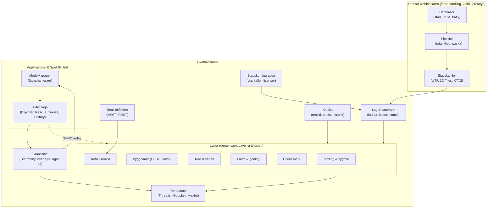

# Stadsplattan — Projektbrief

## 1. Beslutade ramar (låsta standardval)

- **Arbetsnamn:** Stadsplattan.
- **Första stad:** Helsingfors (centrum kring Senatstorget, `60.1695, 24.9525`).
- **Storlek:** Kvadratisk platta, **2 000 × 2 000 m** i Milstolpe 1 (konfigurerbar upp till 5×5 km senare).
- **Djup:** Verkligt djup **50 m** under havsnivå (inställbart per stad, 40–60 m, så att tunnelbana och bergrum ryms).
- **Visuell stil:** Båda lägena med växling — *Modell* (semantisk LOD2 med stiliserade/fysikaliska material) i Milstolpe 1 och *Fotoreal* (fotorealistisk 3D-mesh) i Milstolpe 3.
- **Gränssnitt:** 100 % canvas med ett tunt, overlay-gränssnitt samt en **Startmeny** för att fritt växla mellan nytta och spel.
- **Hosting:** GitHub Pages (upp till ca 1 GB) för appen och lätt data; tunga lager strömmas från CORS-öppna källor eller läggs senare i objektlagring (t.ex. Cloudflare R2).

## 2. Vision

En verklig stads centrum på en skarp, fyrkantig diorama-platta där allt ovan och under mark syns i högsta möjliga detalj, och där användaren via en startmeny kan välja att antingen använda plattan som en **Digital Tvilling** eller spela olika **Spel**.

- **Plattan:** En avgränsad kvadrat vars sidor är skarpa snitt genom marken med jordlager, berg, tunnlar och ledningar. Hav och sjöar syns som genomskuren vattenvolym i kanten.
- **Ovan mark:** Terräng med 5 cm flygfoto, byggnader (LOD2 eller fotorealistisk mesh), broar, träd, gatumöbler och vatten.
- **Under mark:** Tunnelbana, tunnlar, bergrum, geologi och schematisk infrastruktur där öppen data saknas.
- **Levande:** Spårvagnar, bussar, tunnelbana, tåg och fartyg på verkliga positioner, verkligt väder samt sol och skuggor efter verklig tid.
- **Startmenyn:** Portalen till appens olika lägen:
  1. *Digital Tvilling:* Utforska, klicka på byggnader, se realtidstrafik och snittytor under mark.
  2. *Räddningsuppdrag (Spel):* Strategispel där du skickar utryckningsfordon och löser kriser i 3D-miljön.
  3. *Trafikledare (Spel):* Hantera urspårningar och omdirigera kollektivtrafiken under tidspress.
  4. *Tidsresenären (Historia):* Pusselspel eller utforskande genom stadens historia från 1932 till idag.

## 3. Teknisk inriktning och grafikmotor-grind

| Område | Val | Varför |
| --- | --- | --- |
| Motor | `three.js` (`WebGPURenderer` eller `WebGLRenderer` bakom renderer-fabrik) | Störst ekosystem för PBR, skuggor, efterbehandling och glTF (Draco, meshopt, KTX2). Undvik egen grafikmotor. |
| Lägeshantering | Egen `ModeManager` i frontend | För att ladda och städa undan olika spelsystem/gränssnitt utan att röra den underliggande 3D-miljön. |
| 3D Tiles | `3DTilesRendererJS` (NASA-AMMOS) | Färdig strömning, LOD och gallring som läser Helsingfors 3D Tiles direkt. |
| Språk & bygge | TypeScript, Vite, ESLint, Prettier | Strikt typning och moduler i stället för en jättefil. |
| Gränssnitt | Tunt React-lager (eller Lit) ovanpå 100 % canvas | Minimal text, mobil först. Startmeny och overlays. |
| Koordinater | Lokala meter med `proj4js` (`EPSG:3879` ↔ WGS84) | 32-bitars flyttal ger millimeterprecision inom ±5 km utan planetknep. |
| Höjder | Stadens höjdsystem (Helsingfors `N2000`), `y = 0` vid havsnivå | Terräng, byggnader, vatten och tunnlar linjerar exakt. |
| Kvalitet | `low`, `medium`, `high`, `ultra` + dynamisk upplösning | Mobilen ska flyta smidigt utan att strypa datorns Ultra-läge. |
| Förbehandling | Node-pipeline (Claude Code / senare fas) | Klipper och packar glTF / 3D Tiles 1.1 med meshopt och KTX2 för snabb laddning. |

**WebGPU-grind (obligatorisk i Claude Code):** Testa `WebGPURenderer` tillsammans med `3DTilesRendererJS`, skuggor och `THREE.Plane`-klippning i ett minimalt skal innan lagren byggs. Om något av dessa strular med aktuell Three.js-version, lås Milstolpe 1 till `WebGLRenderer` bakom en ren renderer-abstraktion (`src/core/renderer.ts`) och logga beslutet, så WebGPU kan slås på senare utan omskrivning.

## 4. Koordinater och diorama-klippning

- **Högerhänt lokalt system (meter):** Origo `(0, 0, 0)` ligger i plattans mitt (`lat 60.1695, lon 24.9525`) vid havsnivå (`N2000 = 0 m`).
  - `+X` = öst, `+Y` = upp, `-Z` = norr (`+Z` = söder).
  - All koordinatkonvertering (WGS84, `EPSG:3879`, ECEF) samlas i **en enda modul** (`src/core/coordinates.ts`) med enhetstest mot kända punkter i Helsingfors (Senatstorget / Domkyrkan).
- **Helsingfors 3D Tiles-detaljer (från SpaceTrotter):**
  - Tilernas transformer är kumulativa förflyttningar i ECEF från roten.
  - glTF-datat är **Y-upp** och måste roteras till **Z-upp** innan ECEF-transformen appliceras mot lokala meter.
- **Skarpa plattkanter:** Alla ytlager (terräng, 3D Tiles, vatten, tunnlar) måste respektera `ctx.clipPlanes` (fyra vertikala `THREE.Plane` vid `±halfWidth` och `±halfDepth`). Inga byggnader eller markbitar får sticka ut utanför 2×2 km-kanten.
- **Plattans sockel:** Ett eget lager (`slab`) sluter alla fyra sidorna från markytan/havsytan ner till `minY` (`-50 m`) med tydliga jord- och berglager samt en halvtransparent, genomskuren vattenvolym där hamnen och havet möter plattans kant.

## 5. Arkitektur för skalbarhet och spellägen

Skalbarheten bygger på en konfigurationsfil per stad, ett gemensamt `Layer`-gränssnitt för att bygga 3D-världen, samt en `ModeManager` som tillåter oberoende spellägen och digital tvilling-logik att läggas som overlays.



### TypeScript-kontrakt för Miljö, Lager och Lägen

```ts
export type QualityLevel = 'low' | 'medium' | 'high' | 'ultra';

export interface SimTime {
  date: Date;          // aktuell simulerad tidpunkt (sol, skuggor, historik)
  speed: number;       // 1 = realtid, 0 = pausad, >1 = snabbspolning
  isLive: boolean;
}

export interface SlabBounds {
  halfWidth: number;   // meter längs X (öst–väst)
  halfDepth: number;   // meter längs Z (syd–nord)
  minY: number;        // t.ex. -50 m
  maxY: number;        // t.ex. +250 m
}

export interface PickResult {
  layerId: string;
  title: string;
  properties: Record<string, string | number | null>;
}

export interface CityContext {
  scene: THREE.Scene;
  camera: THREE.Camera;
  renderer: THREE.WebGLRenderer | THREE.Renderer;
  bounds: SlabBounds;
  clipPlanes: THREE.Plane[];          // 4 kantplan + ev. användarstyrt snittplan
  toLocal(lon: number, lat: number, elev?: number): THREE.Vector3;
  fromLocal(pos: THREE.Vector3): { lon: number; lat: number; elev: number };
}

export interface Layer {
  id: string;
  label: string;
  category: 'base' | 'surface' | 'underground' | 'live';
  attribution: string[];              // visas i UI när lagret är synligt
  isSchematic?: boolean;              // true för illustrativa lager
  load(ctx: CityContext, signal: AbortSignal): Promise<void>;
  update(time: SimTime, dt: number): void;
  setQuality(q: QualityLevel): void;
  setVisible(v: boolean): void;
  setClipPlanes?(planes: THREE.Plane[]): void;
  pick?(raycaster: THREE.Raycaster): PickResult | null;
  dispose(): void;
}

// Spel- och utforskarlägen (modes)
export type AppMode = 'menu' | 'explore' | 'rescue_game' | 'transit_game' | 'history';

export interface AppModeController {
  id: AppMode;
  title: string;
  description: string;
  setup(ctx: CityContext): Promise<void>;
  update(time: SimTime, dt: number): void;
  onPointerDown?(event: PointerEvent, raycaster: THREE.Raycaster): void;
  teardown(): Promise<void>; // Återställer och städar spelspecifik 3D-grafik, fysik och overlays
}
```

### Stadskonfiguration (`src/cities/helsinki.json`)

```json
{
  "id": "helsinki",
  "name": "Helsingfors",
  "center": { "lat": 60.1695, "lon": 24.9525 },
  "size": { "width": 2000, "depth": 2000, "below": 50 },
  "crs": "EPSG:3879",
  "heightSystem": "N2000",
  "layers": {
    "terrain": { "source": "hel-terrain-2021" },
    "ortho": { "source": "hel-wms", "layer": "avoindata:Ortoilmakuva_2025_5cm" },
    "buildings": { "source": "hel-lod2" },
    "transit": { "source": "hsl-hfp" }
  }
}
```

## 6. Grafik och prestandabudget

Hög detaljkänsla kommer först från ljus, skuggor och material — inte bara fler polygoner.

- **Ljus och himmel:** Verklig solposition från datum, klockslag och koordinat; fysikalisk himmel med IBL; mjuk övergång dag–skymning–natt.
- **Skuggor & AA:** Skuggkartor (CSM på High/Ultra), ambient occlusion (GTAO/SSAO på High/Ultra) och bra kantutjämning för fönsterkarmar och räcken.
- **Byggnader:** *Modell*-läge (LOD2 med smakfulla fasad- och takmaterial efter användning/byggår) och senare *Fotoreal* (2024-mesh).
- **Mark och terräng i Milstolpe 1:** Hämta 5 cm WMS-flygfoto över plattan som skarp, kaklad textur på markmesh. För snabb vertikal skiva i Milstolpe 1 kan marken börja med ett rent höjdgrid (från `Korkeusmalli_2021_50cm` eller kustlinje + låga markhöjder) och sedan kopplas till full terrängmodell utan att blockera byggnaderna.
- **Vatten:** Reflektioner och subtila vågor på ytan, samt genomskuren vattenvolym i plattans ytterkant.
- **Natt (Milstolpe 3):** Punktvisa fönsterljus och gatlyktor (aldrig mjukt brus som ser fläckigt ut nära).
- **Efterbehandling:** AgX eller ACES tonemapping, diskret bloom och valfri tilt-shift för miniatyrkänsla.
- **Prestandabudget:** Inbyggd mätare visar FPS och bildtid (ms). Mål: **60 FPS på dator**, minst **30 FPS på Galaxy Fold** i läget `medium`.

## 7. Gränssnitt, mobil (Galaxy Fold) och testkrokar

Canvasen tar alltid **100 % av skärmytan**. Inga fasta sidopaneler eller långa förklaringstexter.

- **Välkomst- & Startmeny (Start Menu):** Snygg, transparent menypanel med Helsingfors-dioramat snurrande i bakgrunden. Spelaren kan välja mellan:
  - *Digital Tvilling (Utforska)*
  - *Räddningsuppdrag (Spel)*
  - *Trafikledare (Spel)*
  - *Historiska Reglaget (Historia)*
  Innehåller även en länk till "Mina data" och en snabbinställning för grafik-kvalitet.
- **Smal skärm (stängd Fold / mobil):** En kompakt verktygsrad i nederkant (hem/meny-knapp, lager, tid/sol, kvalitet, kamera-reset) + diskret källhänvisning och versionsstämpel i ett hörn. Menyer öppnas som en bottom sheet på max 45 % skärmhöjd.
- **Uppvikt skärm (kvadratisk Fold / surfplatta / dator):** Hopfällbar, flytande panel i ett hörn som aldrig täcker plattans centrum. Spelgränssnitt som overlays.
- **Touchgester:** 1 finger = kretsa, 2 fingrar nyp = zooma, 2 fingrar parallell dragning = panorera, 2 fingrar vertikal dragning = luta (pitch).
- **Interaktion & val:** Kort tryck/klick utan kamerarörelse i *Utforska*-läget visar ett litet flytande kort med adress, byggår, våningar och användning. I spel-lägen fungerar klick istället för att välja olyckor, skicka utryckningar eller lägga spår. Kamerarörelse och första laddning väljer aldrig något oavsiktligt.
- **Testkrokar från dag ett:** Exponera `window.__stadsplattan` med:
  - `setCamera(pos, target)`
  - `setTime(isoString)`
  - `setQuality(level)`
  - `setAppMode(mode)` (t.ex. `'menu'`, `'explore'`, `'rescue_game'`)
  - `setLayerVisible(id, visible)`
  - `getStats()` (FPS, frameMs, drawCalls, triangles)
  - Stöd för `?headless` och `capture()` samt animationer på väggklocka (inte bildrutetakt).

## 8. Under mark: hybridmodell (verkligt + schematiskt)

Plattans djup (50 m) och snittplanet (Milstolpe 4) kombinerar två tydligt åtskilda datatyper:

1. **Verifierad/georefererad data:** Tunnelbanelinjer, stationer och vägtunnlar från OpenStreetMap (`railway=subway`, `tunnel=yes`, `layer`) kombinerat med dokumenterade stationsdjup (Helsingfors metro ligger ofta 20–30 m ner) och Helsingfors [underjordiska generalplan 2021](https://www.hel.fi/hel2/ksv/liitteet/2021_kaava/mayk12704_KARTTA_Helsingin_maanalainen_yleiskaava_2021.pdf) som referens, samt markyta från `Korkeusmalli_2021_50cm`. För bergyta: undersök GTK.
2. **Schematisk infrastruktur (`isSchematic: true`, märkt som illustration i UI):** Genereras längs gatunätet enligt nordiska standarddjup så snittytorna blir begripliga utan att utge sig för att vara ledningskartor:
   - El & fiber: ca 0,6–1,0 m under gatunivå
   - Fjärrvärme: ca 1,0–1,5 m
   - Vatten & avlopp (VA): ca 1,8–2,8 m
   - Berggrundsgräns, djupa tunnlar & bergrum: 15–45 m

## 9. Verifierad data för Helsingfors

Allt nedan är **CC BY 4.0 ("Helsingin kaupunki")** med öppen CORS (speglar origin, fungerar på GitHub Pages och localhost).
`…` = `https://kartta.hel.fi/3d/datasource-data`

| Data | Adress | Noteringar |
| --- | --- | --- |
| Lagerlista | `https://kartta.hel.fi/3d/app.config.json` → `configs/c4f95e20-bb50-44ec-b175-c6724b354d68.json` | Stadens visare; listar alla lager |
| Byggnader LOD2 | `…/16fc3fd5-df6d-4f48-bfd5-9aeee430a02f/tileset.json` | **Testad i SpaceTrotter.** glTF utan Draco, position + normal + feature-id (stride 28). Attribut: adress, våningar, användning, byggår, byggnads-id |
| Byggnader LOD2, texturerade | `…/e5e7158a-52df-45a1-9be0-1be8f2828abd/tileset.json` | Ej testad |
| Byggnader LOD1 | `…/28b3e52b-761b-4211-aff8-682c11648c3e/tileset.json` | Ej testad |
| Rivna byggnader LOD2 | `…/7b918ec0-7694-436b-8787-d8cc7fa9f30b/tileset.json` | För tidsreglage; texturerad variant `…/da3f20e1-6b5c-41f1-8fd9-60d3835018e5/` |
| Fotorealistisk mesh 2024 | `https://kartta.hel.fi/3d/mesh/Helsinki_2024` | Ej testad. Även 2015, 2017 samt delområden (Alppila 2023, Sompasaari 2019, Uunisaari 2026) |
| Gatu- och parkträd | `…/7afdc4b9-9a23-4a6f-a1ae-cf71495a731e/tileset.json` | Ej testad |
| Tomt- och skogsträd | `…/561e9651-878a-45a6-99e3-e4e4704d8001/tileset.json` | Ej testad |
| Broar LOD3 | `…/b1300b5d-3ebb-4bd4-9ade-5c810c4a3a4b/tileset.json` | Ej testad |
| Solpotential på tak | `…/a43e65e7-b2b1-4204-b428-e1c627fbf00f/tileset.json` | Variant med trädskugga `…/a5c57582-2eef-4c41-847b-8aec0b7a5c33/` |
| Terräng 2021 | `…/4383570b-33a3-4a9f-ae16-93373aff5ffa/` | Cesium quantized-mesh |
| Höjdmodell 50 cm | `https://hri.fi/data/en/dataset/helsingin-korkeusmalli` | Lagret `Korkeusmalli_2021_50cm`, CC BY 4.0 |
| Saarinens plan 1915 | `https://kartta.hel.fi/3d/mesh/Saarinen/Scene/Malli_I_Cesium.json` | Historisk modell, Munkkiniemi–Haaga |
| Flygfoton (WMS) | `https://kartta.hel.fi/ws/geoserver/avoindata/wms`, lager `avoindata:Ortoilmakuva_2025_5cm` | **Testad i SpaceTrotter.** Även 2026 i 5 cm och årgångar från 1932. EPSG:3857 stöds; använd `format=image/vnd.jpeg-png&transparent=true` |
| Byggnader via WFS | `https://kartta.hel.fi/3d/citydb-wfs/wfs` | Överbelastad i test — använd 3D Tiles i stället |

## 10. Data att verifiera före användning (Milstolpe 2+)

Verifiera alltid CORS, format och licens innan kod byggs på dessa källor.

| Data | Källa | Viktigt att tänka på |
| --- | --- | --- |
| Kollektivtrafik i realtid | HSL HFP via `wss://mqtt.hsl.fi:443` | **Prenumerera aldrig okritiskt på hela `/hfp/v2/journey/#` i mobilwebbläsaren** — filtrera per fordonstyp (`tram`, `bus`, `metro`, `ferry`) och/eller geohash/bounding box för plattan, och interpolera rörelser mjukt. |
| Linjer & tidtabeller | HSL GTFS (`http://dev.hsl.fi/gtfs/hsl.zip`, CC BY 4.0) | Saknar HTTPS (*mixed content* i webbläsare). Använd endast i offline-pipeline eller verifiera aktuell HTTPS-adress. |
| Tåg i realtid | `https://rata.digitraffic.fi/api/v1/train-locations.geojson/latest` | CC BY 4.0, källhänvisning: `"Source: Fintraffic / digitraffic.fi"`. |
| Fartyg (AIS) | `https://meri.digitraffic.fi/api/ais/v1/locations` och `/vessels` | Färjorna i hamnen (Tallinn/Stockholm). |
| Vägtrafik | `tie.digitraffic.fi` | Mätstationer; endpoints ska verifieras. |
| Väder | `opendata.fmi.fi` (WFS) | Regn, snö, moln och vind för miljöeffekter. |
| Stadsmiljö / tunnlar | OpenStreetMap via `overpass-api.de` | Gatumöbler, gatlyktor, spår, tunnlar (licens ODbL). |
| Mer Helsingfors | `hri.fi` | Stadscyklar, luftkvalitet, buller m.m. |
| Fler städer (senare) | Esbo (CityGML/WFS), Nederländerna (3D BAG LoD2), Sverige (OSM + Lantmäteriets 2D-byggnader) | Adaptrar per källa med OSM som fallback. |

*(Tillåtna domäner att vitlista i Claude Codes molnmiljö: `kartta.hel.fi`, `mqtt.hsl.fi`, `rata.digitraffic.fi`, `meri.digitraffic.fi`, `tie.digitraffic.fi`, `opendata.fmi.fi`, `overpass-api.de`.)*

## 11. Lärdomar från SpaceTrotter (får inte upprepas)

- **Inga jättefiler och inga hoptryckta rader** (en `//`-kommentar svalde kod och variabelskuggning gav svart skärm).
- **Genomskinliga lager får inte skriva djup (`depthWrite: false`)** — atmosfären dolde byggnader bakom sig.
- **Inget påhittat procedurbrus på stadsterräng** — skapar falska kullar som döljer byggnader.
- **Nattljus som skarpa punkter/fönster**, inte suddigt brus.
- **Prioriterad nedladdningskö (närmast kameran först) med timeout och `AbortSignal`**, så hängande anrop aldrig blockerar det synliga.
- **Molnets testwebbläsare kör ofta ~1 FPS** och säger inget om verklig mobilprestanda; använd testkrokar och ändra aldrig källkoden medan ett test kör.
- **Versionsstämpel i UI** (t.ex. git-hash + byggtid) för att direkt se om webbläsaren visar en gammal cachad version.

## 12. Färdplan och acceptanskriterier (DoD)

Bygg i vertikala skivor: *verifiera data → bygg → testa/skärmdump → commit → deploy*.

1. **Milstolpe 1 — Menyn och Plattan står (bygg detta nu):**
   - Snygg, interaktiv startmeny och "Digital Tvilling / Utforska"-läge som grundläge.
   - Terräng med 5 cm flygfoto, LOD2-byggnader, vatten, genomskuren diorama-sockel (50 m djup) med enkla jord-/berglager, verklig sol med tidsreglage, kretsa/zooma/panorera/luta med touch, byggnads-picking (adress/byggår/våningar), kvalitetsnivåer, källhänvisning, versionsstämpel och testkrokar.
   - **Acceptanskriterier (DoD):**
     - `typecheck` och `build` går igenom utan fel; **0 konsolfel** vid laddning.
     - En välkomst- och startmeny visar alternativen för Utforska samt låsta "kommande" spellägen.
     - Exakt 2 000 × 2 000 m kring Senatstorget med skarpa snittkanter utan utstickande tiles eller markbitar.
     - Byggnader står i rätt skala, rätt väderstreck (ej spegelvända) och vilar på marken utan att sväva.
     - 5 cm flygfoto linjerar med byggnadernas fotavtryck och hamnvattnet syns genomskuren i kanten.
     - Klick/tryck på byggnad visar adress, byggår och antal våningar i utforskarläget.
     - Kvalitetsnivå (`low`–`ultra`), FPS/ms, versionsstämpel och `"Helsingin kaupunki (CC BY 4.0)"` syns och fungerar.
     - Verifierat i datorvy och smal/uppvikt mobilvy (Galaxy Fold).
2. **Milstolpe 2 — Levande stad & Trafikledare (Spel 1):** Spårvagnar och bussar i realtid (HSL MQTT) samt färjor/tåg. Implementering av `AppModeController` för "Trafikledare" där spelaren hanterar fiktiva förseningar, omdirigerar och drar provisoriska buss-/spårvagnslinjer i realtid.
3. **Milstolpe 3 — Detaljrikedom & Historie-läge (Historia):** Träd (3D Tiles), broar (LOD3), växling till fotorealistiskt mesh-läge (2024), nattläge samt integration av "Tidsresenären" med historiska flygbilder (1932–2026) och rivna 3D-byggnader sammankopplade med ett historiereglage.
4. **Milstolpe 4 — Under mark & Räddningsuppdrag (Spel 2):** Underjordiskt snittplan och hybridmodell för geologi/tunnlar/ledningar. Implementering av "Räddningsuppdrag" där olyckor uppstår och spelaren dirigerar blåljusfordon genom gator, samt ner i metron och tunnlar under jord.
5. **Milstolpe 5 — Prestandajustering & Flera städer:** Utvärdering på mobil/Fold, optimeringar (LOD, meshopt), samt stadskonfiguration testad på en andra stad (t.ex. Esbo eller 3D BAG i Nederländerna) via gemensamma adaptrar.